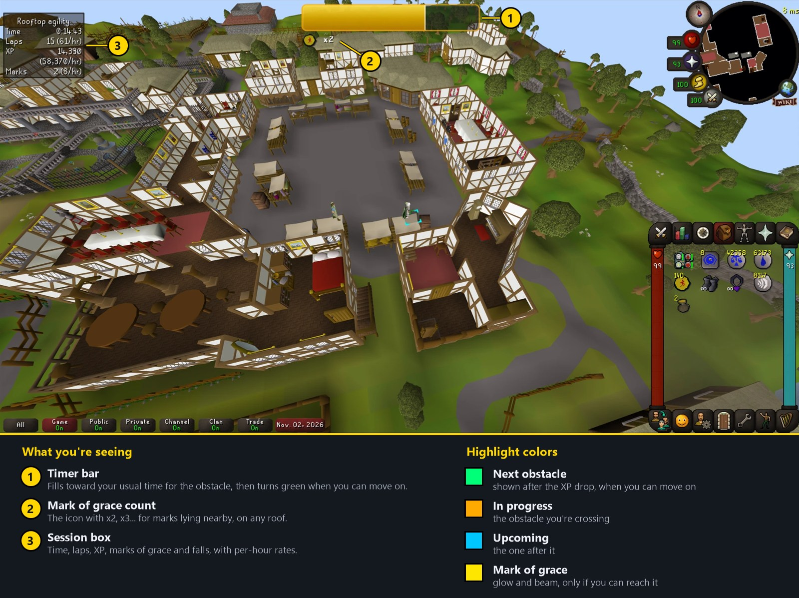
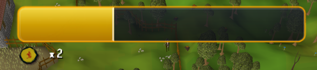
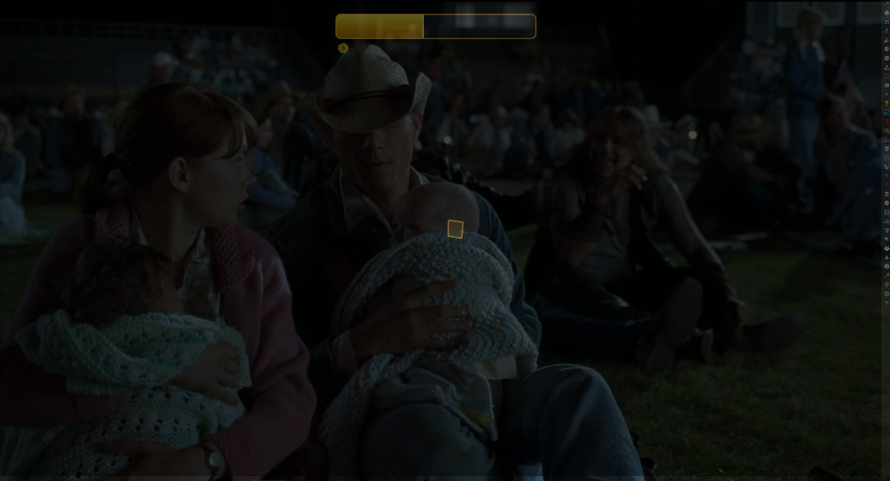

# Rooftop Guide

Shows you the next obstacle on rooftop agility courses, with a crossing timer, marks of grace tracking and a session
box. A transparent mode darkens the game and lets a video show through, so rooftops can be run AFK while you watch
something else. It only draws on screen: it never clicks or moves for you.

## Features

- Highlights the next obstacle, the obstacle you're crossing, and the one after it, each in its own color.
- A timer bar that fills toward how long each obstacle usually takes you, learned from your own laps, and jumps to full
  and green the moment the XP drop says you're free to move on.
- Marks of grace: a glow and light beam on the tile, only when you can actually walk to it, plus a count under the
  timer bar (x2, x3...) for any marks lying nearby, on any roof.
- A session box with time, laps, XP, marks of grace and falls, with per-hour rates.
- Falls are noticed: the timer stops, no lap is counted, and the highlight goes back to the start of the course.
- Transparent mode for watching something while you play (see below).
- Hold Alt to drag the timer bar and the session box; drag the timer bar's edges to resize it, down to very thin.

## Implemented courses

- [x] Ardougne
- [x] Rellekka
- [x] Pollnivneach
- [x] Seers' Village
- [ ] Varrock (set up, but obstacle 6 is not fully verified in game yet)
- [ ] Draynor (set up, not tested in game yet)
- [ ] Al Kharid (set up, not tested in game yet)
- [ ] Canifis (set up, not tested in game yet)
- [ ] Falador (set up, not tested in game yet)

Courses not tested yet start from RuneLite's own obstacle order and correct themselves after the real order has been
seen twice.

## How it picks the obstacle

It follows the course's order. The next obstacle is the one after the one you just finished, which it detects from the
agility XP drop that follows a click. When it doesn't know where you are in the course yet, it falls back to the nearest
obstacle on your level. An obstacle clicked out of order isn't tracked and no lap is counted for it. Turn off the
built-in Agility plugin's obstacle highlighting so the two don't overlap.

## The timer bar

The bar starts on your first click on an obstacle and ends on the XP drop. Spam-clicking doesn't restart it. Clicking
anywhere else interrupts it: the bar disappears and that run isn't learned from. It learns a time for each obstacle and
for the tile you clicked it from (the course is the same tiles every lap), keeps the middle of your last five runs, and
remembers them between sessions, so the bar is empty only for an obstacle you haven't finished yet. The "Warn early"
setting changes its color a little before the usual end.

## Transparent mode

Set a hotkey for it in the plugin's settings (there is none by default). It darkens the game so only the highlights,
timer bar and mark of grace icons show, and lowers the window's opacity so a video behind it shows through. The game's
own click cross is drawn over the dark cover.

- The Darkness setting goes from solid black down to a light dim.
- Window opacity can be changed live in the settings while it is on.
- It needs RuneLite's custom window chrome to be on, and works best with Always on top. The opacity is set on the
  window directly and isn't saved in RuneLite's settings, so it can't get stuck after a crash.
- **Hide interface** (on by default) also covers the inventory, chat and minimap. While they are covered, clicks on
  them do nothing, so they can't be hit by accident; clicks in the game world still work. Turn it off to darken only the
  game view and keep the interface visible and clickable.
- After the last Seers' Village obstacle the interface is shown and clickable, so you can teleport back while the game
  stays dark. It hides again when the next lap starts. A setting turns this off.

## Settings

- **Obstacles:** colors for next, in progress and upcoming; show the in-progress and upcoming highlights; label; max
  distance.
- **Timer bar:** on or off, background opacity, how early it warns.
- **Marks of grace:** highlight on or off, the count under the timer bar, color.
- **Session:** the session box on or off.
- **Transparent mode:** hotkey, darkness, window opacity, hide interface, show interface after a
  Seers' lap.

## Jagex rules

This plugin only draws overlays and changes how the window looks. It does not click, move or press keys for you, add or
change menu entries, move or resize click zones, unhide interface parts, or show anything about boss mechanics, other
players or loot. The one thing that touches input is the interface click block in transparent mode: while the interface
is covered it ignores clicks on interface panels. It sends nothing to the server and never changes anything in the game
world. As I read Jagex's third-party client guidelines, none of their listed prohibitions apply, but the list says it
isn't exhaustive, so the final call is Jagex's and the Plugin Hub reviewers'.
