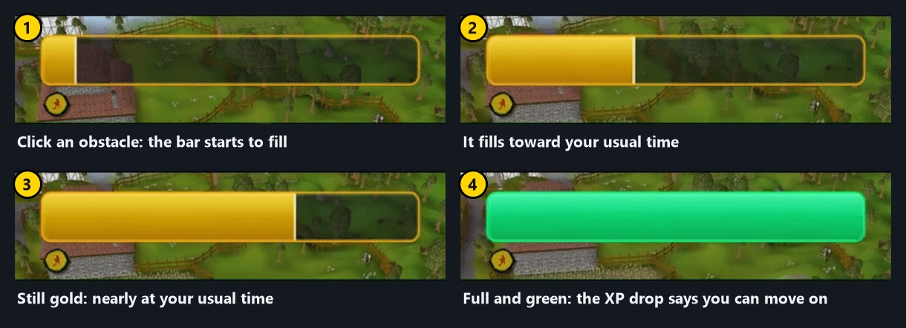

# Rooftop Guide

Shows you the next obstacle on rooftop agility courses, with a crossing timer, marks of grace tracking and a session
box. A transparent mode darkens the game and lets a video show through, so rooftops can be run AFK while you watch
something else. It only draws on screen: it never clicks or moves for you.

## Features

- Highlights the next obstacle, the obstacle you're crossing, and the one after it, each in its own color.
- A timer bar that fills toward how long each obstacle usually takes you, learned from your own laps, and jumps to full
  and green the moment the XP drop says you're free to move on.
- Marks of grace: a glow and light beam on the tile, only when you can actually walk to it, plus a count under the
  timer bar (x2, x3...) for any marks lying nearby, on any roof.
- A session box with time, laps, XP, marks of grace and falls, with per-hour rates.
- Falls are noticed: the timer stops, no lap is counted, and the highlight goes back to the start of the course.
- Predictable Obstacle Mode (optional): while you cross an obstacle, a ghost of the next one shows where it will appear
  on screen once you land, so the mouse can already be there. You choose its color and opacity.
- Transparent mode for watching something while you play (see below).
- Hold Alt to drag the timer bar and the session box; drag the timer bar's edges to resize it, down to very thin.

## Implemented courses

- [x] Ardougne
- [x] Rellekka
- [x] Pollnivneach
- [x] Seers' Village
- [ ] (other courses not tested)

## The timer bar

[Watch the timer bar as an animation (GIF)](https://raw.githubusercontent.com/glurftgim/rooftop-guide/main/screenshots/timer-bar.gif)

The bar starts on your first click on an obstacle and ends on the XP drop. Spam-clicking doesn't restart it. Clicking
anywhere else interrupts it: the bar disappears and that run isn't learned from. It learns a time for each obstacle and
for the tile you clicked it from (the course is the same tiles every lap), keeps the middle of your last five runs, and
remembers them between sessions, so the bar is empty only for an obstacle you haven't finished yet. The "Warn early"
setting changes its color a little before the usual end.

## Predictable Obstacle Mode

An optional mode, off by default. While you cross an obstacle, it draws a ghost of the **next** obstacle where it will
appear on screen once you land, so you can put the mouse there before the jump ends. In the settings you can choose the
ghost's color and how solid its fill is.

It works because the game camera follows your character. The plugin knows the tile each obstacle lands you on, and
shows the next obstacle as the camera will see it from there. A few things to know:

- It measures the camera while you stand still, so it can be slightly off right after you change the zoom or the camera
  angle, until you have stood still for a moment.
- The next obstacle has to be loaded and on screen. If it isn't, no ghost is shown and the normal highlights carry on.
- If you click away in the middle of an obstacle, the ghost disappears, since the obstacle may not finish.

## Transparent mode

Set a hotkey for it in the plugin's settings (there is none by default). It darkens the game so only the highlights,
timer bar and mark of grace icons show, and lowers the window's opacity so a video behind it shows through. The game's
own click cross is drawn over the dark cover.

- The Darkness setting goes from solid black down to a light dim.
- Window opacity can be changed live in the settings while it is on.
- It needs RuneLite's custom window chrome to be on, and works best with Always on top. The opacity is set on the
  window directly and isn't saved in RuneLite's settings, so it can't get stuck after a crash.
- **Hide interface** (on by default) also covers the inventory, chat and minimap. While they are covered, clicks on
  them do nothing, so they can't be hit by accident; clicks in the game world still work. Turn it off to darken only the
  game view and keep the interface visible and clickable.
- After the last Seers' Village obstacle the interface is shown and clickable, so you can teleport back while the game
  stays dark. It hides again when the next lap starts. A setting turns this off.

## Settings

- **Obstacles:** colors for next, in progress and upcoming; show the in-progress and upcoming highlights; label; max
  distance.
- **Predictable obstacle:** the mode on or off, the ghost's color, the ghost's opacity.
- **Timer bar:** on or off, direction (horizontal or vertical, horizontal by default), background opacity, how early it warns.
- **Marks of grace:** highlight on or off, the count under the timer bar, color.
- **Session:** the session box on or off.
- **Transparent mode:** hotkey, darkness, window opacity, hide interface, show interface after a
  Seers' lap.

## Credits

Predictable Obstacle Mode uses the camera method and the obstacle landing tiles from
[rooftop-obstacle-preview](https://github.com/burkeg/rooftop-obstacle-preview) by burkeg, and the same idea is in
[Simple Ardougne Rooftop](https://github.com/Humperd7nck/ardougne-next-obstacle) by Humperd7nck. See
THIRD_PARTY_NOTICES.md.
